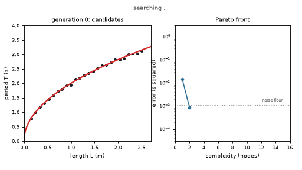
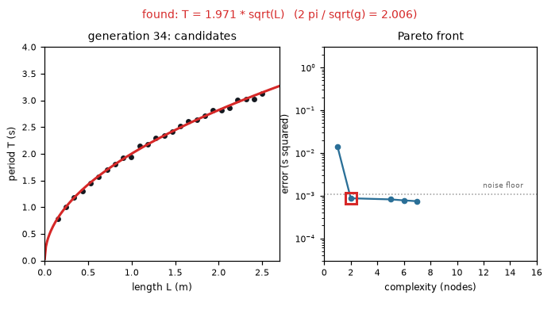
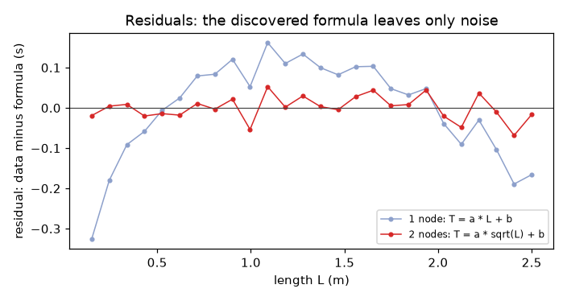
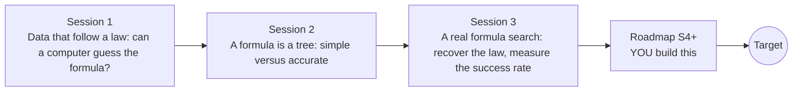

# opensymbolic

[](https://github.com/KrunalPanchal1995/opensymbolic/actions/workflows/ci.yml)   [](https://colab.research.google.com/github/KrunalPanchal1995/opensymbolic/blob/main/sessions/session-01/lesson.ipynb) [](https://krunalpanchal1995.github.io/opensymbolic/)

**Let a computer rediscover a physical law from data, in three sessions.**

opensymbolic teaches symbolic regression, the search for a formula rather than a black-box fit, from falling balls to a working numpy search that you can test on noisy data.

- **Start from a falling ball.** Session 1 needs only school algebra; every formula is explained from scratch.
- **See the trade-off.** Every session ships a slider app that runs in the browser, with labelled graphs.
- **Know you got it right.** Each session ends with a checkpoint that prints PASS or FAIL against hand calculations and measured success rates.
- **Build the missing half.** The repo stops at an enumeration search on purpose; the roadmap shows the path to the Target.

[Target](#the-target) · [Who is this for](#who-is-this-for) · [Quick start](#quick-start) · [Sessions](#sessions) · [Roadmap](#roadmap) · [Contribute](#contribute) · [Explainer PDF](docs/explainer.pdf)

> **This repo is incomplete on purpose.** Sessions 1 to 3 are here and fully working. The finished Target below is a preview of what the community can build next. We show you the path, not the code. Sessions 4 and up are yours.

## The Target

A genetic search starts from random formulas and tries to explain noisy pendulum measurements. Candidate curves flicker over the data, each generation a little closer. On the right, the Pareto front of complexity against error grows downwards until it reaches the noise floor, and at the end the equation is revealed: the period grows like the square root of the length. Your goal over the coming sessions: build a search that finds such a law, then make it handle many inputs, awkward constants and uneven noise.



*Target: a genetic search rediscovers the pendulum law while the Pareto front grows*



*Target, final frame: the discovered formula and its place on the Pareto front*



*Residuals: the discovered formula leaves only noise, the simpler rival leaves a curve*

Try it live:

- [Math Visual Studio: regression and fitting (Atlas S26)](https://krunalpanchal1995.github.io/studio/#atlas?ch=S26&ex=1)
- [Math Visual Studio: the Studio home](https://krunalpanchal1995.github.io/studio/)

How the Target was made is shown only as a path in [promo/roadmap.md](promo/roadmap.md).

## Who is this for
**higher secondary to advanced undergraduate (levels 4-6).** Topic area: Artificial Intelligence, Data Science and Robotics.

Prerequisites:

- School algebra: powers, square roots, the idea of a function y = f(x).
- Python 3.10 or newer; if `python --version` works, you are ready. PRIMER.md explains the rest.
- No prior GitHub, statistics or machine-learning experience is needed.

New to Python? Read [PRIMER.md](PRIMER.md) first (10 minutes).

## Quick start

No installation knowledge needed. You need [Git](https://git-scm.com/downloads) and [Python 3.10+](https://www.python.org/downloads/) (Windows: tick "Add Python to PATH"). On Mac and Linux type `python3` wherever this page says `python`.

```bash
git clone https://github.com/KrunalPanchal1995/opensymbolic.git
cd opensymbolic
python start.py 1
```

`start.py` creates a private environment, installs what is needed and runs Session 1 with its checkpoint. Next: `python start.py 2`, `python start.py 3`, or `python start.py test` to check everything. Only a checkpoint: `python start.py check 1`.

Five lines turn the idea of Session 1 into a result (they work as they are): Save it as `try.py` and run it with `python start.py run try.py` (this uses the private environment, where NumPy is installed):

```python
import numpy as np
t = np.array([0.5, 1.0, 1.5, 2.0, 2.5, 3.0])                       # seconds
d = 4.905 * t**2 * (1 + np.array([.02, -.03, .01, -.02, .03, -.01]))  # metres fallen, with errors
for n in (1, 2, 3):                                                  # try d = c * t^n
    f = t**n; c = (f * d).sum() / (f * f).sum(); print(n, round(c, 3), round(np.mean((d - c * f)**2), 3))   # n = 2 has by far the smallest error
```

Every session also opens in your browser with sliders (no install): [live apps](https://krunalpanchal1995.github.io/opensymbolic/). Or use the Colab badge above for the notebook.

## Sessions

| # | Session | Model level | Time | Live app |
|---|---|---|---|---|
| 1 | [Data that follow a law: can a computer guess the formula?](sessions/session-01/README.md) | Level 1: conceptual interactive model | 60 min | [open](https://krunalpanchal1995.github.io/opensymbolic/session-01/) |
| 2 | [A formula is a tree: simple versus accurate](sessions/session-02/README.md) | Level 2: mathematical engineering model | 75 min | [open](https://krunalpanchal1995.github.io/opensymbolic/session-02/) |
| 3 | [A real formula search: recover the law, measure the success rate](sessions/session-03/README.md) | Level 3: simulation and validation | 90 min | [open](https://krunalpanchal1995.github.io/opensymbolic/session-03/) |

Each session follows the same six steps: A real-world problem, B concept and theory, C visual explanation, D interactive simulation, E worked example and experiment, F assessment and design challenge. Each ends with `checkpoint.py`, which prints `PASS` or `FAIL` against reference numbers. Session 3 also contains the real-world mini-project: **Find a rate law from synthetic kinetics data**.

## Architecture



| Folder or file | What is inside |
|---|---|
| `sessions/` | three sessions: README (A-F), `lesson.py`, notebook, live app, exercises, activity sheet, checkpoint |
| `promo/` | the Target: media, live links, and the roadmap (path only) |
| `docs/` | `explainer.tex` and the built `explainer.pdf` |
| `tests/` | runs every lesson and checkpoint headless |
| `start.py` | one command to set up and run anything |
| `QUALITY.md`, `RUBRIC.md` | the quality checklist and the scoring rubric |
| `.github/` | CI, PDF build, Pages deploy, issue and PR templates |

## Roadmap

| Milestone | What you will build | Difficulty |
|---|---|---|
| Session 4: Constants inside the formula | A search that fits two constants inside the formula by iteration, not only a and b outside. | intermediate |
| Session 5: More than one input | A search over formulas in x1 and x2 that recovers r = x1 sqrt(x2). | intermediate |
| Session 6: Weighted errors | A weighted least-squares version of the search. | advanced |
| Session 7: A genetic search for bigger spaces | A genetic loop with a complexity penalty. | advanced |
| Session 8: Leave-one-class-out validation | A validation function that holds out one class of synthetic reactions at a time. | advanced |

Full detail with a checkpoint per milestone: [promo/roadmap.md](promo/roadmap.md).

## Contribute
New to GitHub? Read [CONTRIBUTING.md](CONTRIBUTING.md); it starts from zero. Pick an issue labelled `good first issue`. Translations into Hindi, Telugu, Tamil and Malayalam are welcome.

<details>
<summary>Development</summary>

```bash
python start.py test        # runs every lesson and checkpoint
```
Lessons use `# %%` cell markers so they open as notebooks in VS Code. See [QUALITY.md](QUALITY.md) for the standard every session meets.
</details>

## License
MIT. See [LICENSE](LICENSE). Media in `promo/media` is (c) Krunal Panchal, CC BY 4.0.

## Acknowledgments
Part of the [PAN IIT OSS](https://hellofoss.tech-iitb.org/projects) open-source teaching collection, modelled on the structure of [openspline](https://github.com/openspline/openspline). Built on ideas from the Math Visual Studio at https://krunalpanchal1995.github.io/studio/.
