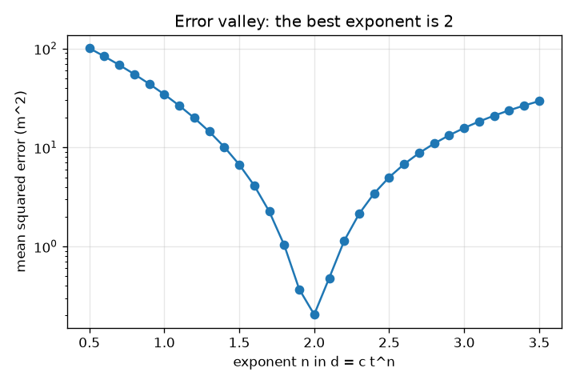
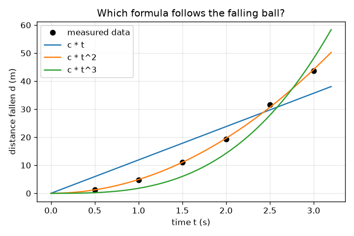

# Session 1: Data that follow a law: can a computer guess the formula?

*Level 1 (conceptual interactive model) · about 60 minutes · opensymbolic*

> This is a simplified educational model. It is not a validated design tool and must not be used for real structures, electrical installations, vehicles, industrial processes or medical decisions.

**Prerequisites**

- School algebra: powers such as t^2 and the idea of a formula.
- You have read PRIMER.md and run `python start.py 1` once.

**Learning objectives.** After this session you can:

- Explain what it means for measured data to follow a law, and why measurements never match it exactly.
- Fit the one unknown constant c in d = c t^n by least squares.
- Score a candidate formula by its mean squared error and rank candidates.
- Read an error-versus-exponent curve and explain why its lowest point is a good guess for the law.

## A. Real-world problem
Drop a ball from a tower and time how far it has fallen after each half second. The numbers rise faster and faster, but is the distance proportional to the time, to its square, to its cube? Galileo had to guess a formula and test it. A computer can do the guessing: write many candidate formulas, fit each one, and keep the one that matches the data best. That is the seed of symbolic regression, a method that finds an equation rather than only a curve, and that scientists use today to look for interpretable rules in chemistry, for example for reaction rates.

## B. Concept and theory
Free fall from rest follows d = (1/2) g t^2, where d is the distance fallen in metres, t the time in seconds and g the acceleration due to gravity, 9.81 m/s^2 on Earth. Real measurements carry errors, so we model them by multiplying each distance by (1 + e) with a small fractional error e. A candidate formula has the form d = c t^n: the exponent n is chosen by the search and the constant c is found by least squares. Minimising the sum of squared differences between data and formula gives c = sum(f d) / sum(f f), where f = t^n. The score is the mean squared error (MSE): the average of the squared differences, in metres squared. If the winning exponent is 2, then c = g / 2 and so g = 2c.

| Symbol | Meaning | Unit |
|---|---|---|
| d | distance fallen from rest | m |
| t | time since release | s |
| g | acceleration due to gravity | m/s^2 |
| c | the constant fitted for a candidate formula | m/s^n |
| n | exponent of t in the candidate | no unit |
| MSE | mean squared error of a candidate | m^2 |
| e | fractional measurement error of one point | no unit |

**Assumptions**

- The ball starts from rest and air resistance is ignored.
- Errors are small, between -3 and 3 percent here, and we use six fixed values so that everyone gets the same data.
- Every candidate has the form c times a shape; we do not yet allow constants inside the formula.

$$ d=\tfrac12\,g\,t^2 $$

$$ c=\frac{\sum_i f_i\,d_i}{\sum_i f_i^2},\qquad f_i=t_i^{\,n} $$

$$ \mathrm{MSE}=\frac1N\sum_{i=1}^{N}\big(d_i-c\,t_i^{\,n}\big)^2 $$

$$ d=c\,t^2\ \Rightarrow\ g=2c $$

## C. Visual explanation
The left figure shows the six measured points and three candidate curves: distance proportional to t (too flat at the end), to t cubed (too steep) and to t squared, which passes through the cloud. The right figure plots the error against the exponent n on a log axis: a deep valley with its lowest point at n = 2.0, where the error is 0.20 m^2, against 34.39 m^2 at n = 1 and 15.73 m^2 at n = 3. A good formula search is a descent into such a valley.

*Error against the exponent n: the valley is at n = 2.*

*Six measured points and three candidate formulas: only t squared follows the data.*

## D. Interactive simulation
Run the lesson (`python start.py 1`), then open the live app: [Session 1: guess the falling-ball formula](https://krunalpanchal1995.github.io/opensymbolic/session-01/) (or `app.html` in this folder). Choose a gravity and an exponent. Watch the filled balls (measured) and the rings (formula), then switch to the graph view and see how the error changes as the exponent moves.

**Challenge.** Set the gravity to Mars (3.71 m/s^2) and choose the exponent that fits best.

## E. Worked example and experiment
**Problem.** Fit d = c t^2 to the six measured distances for the falling ball (times 0.5, 1, 1.5, 2, 2.5, 3 s) and estimate g.

1. Measured distances are 1.251, 4.758, 11.147, 19.228, 31.576 and 43.704 m (the true values times (1 + e)).
2. The shapes f = t^2 are 0.25, 1, 2.25, 4, 6.25 and 9. Their squares sum to sum(f f) = 142.1875.
3. Multiply each shape by its distance and add: sum(f d) = 697.742.
4. c = 697.742 / 142.1875 = 4.907 m/s^2.
5. The mean squared error is 0.205 m^2, and g = 2c = 9.81 m/s^2, the known value.

**Answer.** c = 4.907, MSE = 0.205 m^2 and g = 9.81 m/s^2.

**Experiment.** Drop a ball (or a coin) from a balcony 3 m up and film it with a phone at 60 frames per second; read the height from a ruler in the picture frame by frame. Fit d = c t^2 as above. You will get g within a few percent, but not exactly 9.81: the timing of the first frame is uncertain, air drag is small but not zero, and the ruler is read by eye. The model here is exact, the experiment is not.

## F. Assessment and design challenge
**Question type A: Conceptual.** Two exponents, n = 1.9 and n = 2.1, give errors of 0.37 and 0.48 m^2, close to the 0.20 m^2 of n = 2. Can the data prove that n is exactly 2?

Hint

Think about the measurement errors of up to 3 percent.

Step-by-step solution

No. The data show that n is close to 2 and that n = 1 or n = 3 are far worse, but with errors of a few percent the neighbouring exponents 1.9 and 2.1 are only about twice as bad. A law is chosen because it is the simplest formula that fits within the noise and also has a physical reason (here d = (1/2) g t^2 from constant acceleration), not because the error is exactly zero.

**Question type B: Numerical.** A shape f = (1, 2) is fitted to the data d = (3, 5) with d = c f. Find c and the MSE by hand.

Hint

Use c = sum(f d) / sum(f f), then average the squared differences.

Step-by-step solution

sum(f d) = 1*3 + 2*5 = 13 and sum(f f) = 1 + 4 = 5, so c = 13/5 = 2.6. The formula gives (2.6, 5.2), so the differences are 0.4 and -0.2 and MSE = (0.16 + 0.04) / 2 = 0.1. Units: the square of the units of d.

**Question type C: Graph and simulation interpretation.** On the error-versus-exponent curve, the error at n = 1 is 34.39 m^2 and at n = 3 it is 15.73 m^2. Which wrong guess is worse, and where is the minimum?

Hint

Compare the heights of the curve at n = 1 and n = 3 and find the lowest point.

Step-by-step solution

The minimum is at n = 2.0 with error 0.20 m^2. The exponent 1 is worse than the exponent 3 here (34.39 against 15.73 m^2). The valley is not symmetric because the times lie between 0.5 and 3 s, and a t^3 curve is closer to t^2 over that range than a straight line is.

**Question type D: Design and optimisation challenge.** Design: you can time only four drops with a stopwatch accurate to about 0.1 s. Choose the drop times (or heights) and say how you would decide between n = 1.5, 2 and 3, and what would make your decision more reliable.

Hint

Spread the times widely and repeat measurements; remember that the distance error depends on the timing error.

Step-by-step solution

Use times spread over the whole range, for example 0.5 to 3 s, because the candidates only differ clearly at large t. Repeat each drop several times and average to reduce the timing error. Fit every candidate and compare MSE; prefer the simplest candidate within the noise. A further constraint is that long drops need a tall tower and air drag grows with speed. The trade-off is range (more distinguishing power) against practicality and drag.

Score yourself with [RUBRIC.md](../../RUBRIC.md). Print the [activity sheet](activity_sheet.md) to work on paper.

## Common misconceptions
| Common misconception | What is actually true |
|---|---|
| A formula that fits the data has to be the true law. | Many formulas fit noisy data about equally well; we choose among them using simplicity and physical reasons as well as error. |
| Zero error means the formula is perfect. | Real data have noise, so a formula with exactly zero error on the training data usually fits the noise too. |
| The constant c is just a number to guess. | For d = c f(t) the best c has an exact formula, so no guessing is needed. |
| Heavier balls fall faster, so the law must contain mass. | In this model the distance does not depend on mass, because gravity's pull and the inertia of the ball cancel out. Air drag, which we ignore, is the reason a feather is slower. |

## Glossary
- **symbolic regression**: searching for a formula (an equation) that explains data, not just a curve
- **candidate formula**: one possible formula whose score we compute
- **least squares**: choosing constants so that the sum of squared differences is as small as possible
- **mean squared error (MSE)**: average of the squared differences between data and formula
- **exponent**: the small raised number n in t^n

## Finish
1. Do the three coding tasks in [exercises.md](exercises.md).
2. Run `python start.py 1` again after your changes. It ends with the checkpoint; when it prints `PASS`, you are done. (Checkpoint only: `python start.py check 1`.)

Next: [Session 2](../session-02/README.md)
