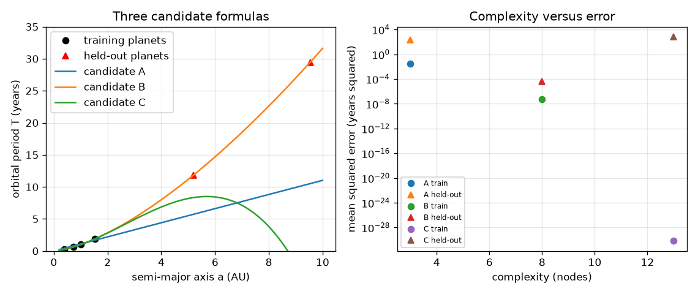

# Session 2: A formula is a tree: simple versus accurate

*Level 2 (mathematical engineering model) · about 75 minutes · opensymbolic*

> This is a simplified educational model. It is not a validated design tool and must not be used for real structures, electrical installations, vehicles, industrial processes or medical decisions.

**Prerequisites**

- Session 1: candidate formulas, least squares and mean squared error.
- Powers and square roots; the idea of a held-out test.

**Learning objectives.** After this session you can:

- Represent a formula as an expression tree and evaluate it with numpy.
- Count the complexity of a formula as its number of nodes.
- Compute the error of three candidates on Kepler's third law data and place them on a complexity-versus-error plot.
- Use a held-out set to detect a formula that fits the training data by overfitting.

## A. Real-world problem
Kepler's third law links the time a planet needs to circle the Sun (its period T) to its distance a from the Sun. With six planets you can write a short formula, a medium one and a very flexible one, and all of them may fit the planets you used. Which would you trust to predict a planet farther out? A symbolic regression program faces this choice for millions of formulas, so it needs a way to measure how complicated a formula is and a way to test it on data it has not seen.

## B. Concept and theory
We store a formula as a tree. Leaves are the variable x or a number; inner nodes are operations: add, sub, mul, div (two children) and sqrt, exp, log, sq (one child). The complexity of the formula is the number of nodes. The error is the mean squared error on data. A formula is on the Pareto front if no other formula is both simpler (or equal) and more accurate. Flexible formulas can always lower the training error, so the training error alone favours the biggest formula; to judge honestly we hold out part of the data, never use it for fitting, and compare errors on it. Kepler's law is T^2 proportional to a^3, which means T = c a^(3/2) with c = 1 when T is in years and a in AU (astronomical units, the Earth-Sun distance).

| Symbol | Meaning | Unit |
|---|---|---|
| a | semi-major axis of the orbit | AU |
| T | orbital period | years |
| c, c0..c3 | constants fitted by least squares | depends on the formula |
| nodes | complexity: number of nodes in the tree | no unit |
| MSE | mean squared error | years^2 |

**Assumptions**

- Planets are treated as points on circular or elliptical orbits around the Sun with the same law.
- Textbook values are rounded to 3 or 4 digits, so even the exact law has a tiny error (about 1.0e-5 years^2).
- Training planets: Mercury to Mars; held-out planets: Jupiter and Saturn.

$$ T^2\propto a^3\ \Rightarrow\ T=c\,a^{3/2} $$

$$ \text{complexity}=\text{number of nodes in the tree} $$

$$ \mathrm{MSE}=\frac1N\sum_i\big(f(a_i)-T_i\big)^2 $$

$$ f_C(a)=c_0+a\big(c_1+a(c_2+c_3 a)\big) $$

## C. Visual explanation
The left figure plots period against distance for the six planets with three candidate curves. Candidate A (a straight line through the origin) misses Mars and Jupiter. Candidate B (the 3/2 power law) passes through all six. Candidate C (a cubic) goes exactly through the four training planets but swings far away from Jupiter and Saturn. The right figure places the candidates on a plot of complexity against error: C has the smallest training error and the largest held-out error.

*Three candidate formulas on the planets, and their complexity versus error.*

## D. Interactive simulation
Run the lesson (`python start.py 2`), then open the live app: [Session 2: three formulas for Kepler's third law](https://krunalpanchal1995.github.io/opensymbolic/session-02/) (or `app.html` in this folder). Pick a model and the number of training planets. Look at the tree diagram, then at the graph; compare the training error with the held-out error.

**Challenge.** Find a setting whose held-out planets are predicted well (held-out error below 0.001 years squared).

## E. Worked example and experiment
**Problem.** Build the tree for T = c sqrt(a a a) with c = 1 and use it to predict the period of Mars (a = 1.524 AU). Count its complexity.

1. The tree is mul(c, sqrt(mul(a, mul(a, a)))). Its nodes are mul, c, sqrt, mul, a, mul, a, a: 8 nodes (with c = 1 as a number node).
2. Evaluate from the leaves: a * a * a = 1.524^3 = 3.540.
3. Take the square root: sqrt(3.540) = 1.8814, and multiply by c = 1.
4. The observed period of Mars is 1.881 years, so the prediction matches to 3 decimals.
5. With the fitted constant (0.9999) the same tree predicts 11.867 years for Jupiter against an observed 11.862.

**Answer.** Complexity 8 nodes; Mars: 1.8814 years against 1.881 observed.

**Experiment.** Use a telescope or an astronomy app to look up the periods and distances of the Galilean moons of Jupiter, whose periods are in days and distances in thousands of km; fit T = c a^1.5 and check that c is the same for all of them. The law is exact for point masses; real data differ by measurement error and by small forces from other bodies.

## F. Assessment and design challenge
**Question type A: Conceptual.** Why is it not enough to choose the formula with the smallest training error?

Hint

Think about a formula with as many constants as data points.

Step-by-step solution

A flexible formula can pass exactly through the training points, so its training error can reach almost zero (the cubic here has an error below 1e-20 on four points), while its predictions elsewhere are wild (held-out error 645.0 years squared). The training error rewards flexibility, not truth. We need a held-out set or a penalty for complexity.

**Question type B: Numerical.** Draw the tree for x^2 - 2 using sq, sub and a number node. Count the nodes and evaluate it at x = 3.

Hint

The root is the subtraction. Its children are sq(x) and the number 2.

Step-by-step solution

The tree is sub(sq(x), 2): nodes sub, sq, x, 2, so complexity 4. At x = 3: sq(3) = 9 and 9 - 2 = 7.

**Question type C: Graph and simulation interpretation.** On the complexity-versus-error plot, which candidate has the lowest training error and which the lowest held-out error? What does that tell you?

Hint

Compare the three markers for training and held-out error.

Step-by-step solution

C (13 nodes) has the lowest training error but the highest held-out error (645.0 years squared). B (8 nodes) has a held-out error of about 4e-5 years squared, far better than A (198.2) and C. So training error and trustworthiness are different things; the held-out error picks B.

**Question type D: Design and optimisation challenge.** Design: use the rule 'accept a formula only if its held-out error is below 0.01 years squared, and then choose the one with the fewest nodes'. Which candidate is chosen? What changes if Jupiter is moved into the training set?

Hint

Compute the held-out errors of A, B and C. For the second part train on five planets and hold out only Saturn.

Step-by-step solution

Only B passes the threshold (A: 198.2, C: 645.0), so B is chosen. With five training planets (Mercury to Jupiter) and Saturn held out, C's held-out error is still 43.4 years squared, B's is below 1e-3, so B is still chosen. Trade-off: more training data helps the flexible formula but not enough; a formula with the right structure needs fewer data.

Score yourself with [RUBRIC.md](../../RUBRIC.md). Print the [activity sheet](activity_sheet.md) to work on paper.

## Common misconceptions
| Common misconception | What is actually true |
|---|---|
| A bigger formula is always a better model. | A bigger formula fits the training data at least as well, but it often fails on new data. |
| The error on the data I used to fit tells me how good the formula is. | It only tells how well it fits those points. You need held-out data. |
| Complexity means how hard the formula looks. | Here it is an exact count: the number of nodes in the tree. |
| The exact law has zero error on real data. | Textbook numbers are rounded, so even T = a^1.5 has a small error (about 1.0e-5 years squared). |

## Glossary
- **expression tree**: a formula stored as nodes and branches
- **node**: one leaf (a number or the variable) or one operation in a tree
- **complexity**: the number of nodes of a formula
- **Pareto front**: the set of formulas that no other formula beats in both simplicity and accuracy
- **held-out set**: data kept aside and never used for fitting
- **overfitting**: fitting the noise or the training points so closely that new data are predicted badly

## Finish
1. Do the three coding tasks in [exercises.md](exercises.md).
2. Run `python start.py 2` again after your changes. It ends with the checkpoint; when it prints `PASS`, you are done. (Checkpoint only: `python start.py check 2`.)

Next: [Session 3](../session-03/README.md)
