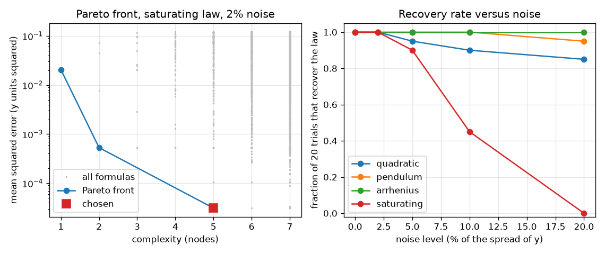

# Session 3: A real formula search: recover the law, measure the success rate

*Level 3 (simulation and validation) · about 90 minutes · opensymbolic*

> This is a simplified educational model. It is not a validated design tool and must not be used for real structures, electrical installations, vehicles, industrial processes or medical decisions.

**Prerequisites**

- Session 1: least squares for a constant.
- Session 2: expression trees, complexity, held-out data.
- Logarithms and the exponential function.

**Learning objectives.** After this session you can:

- Enumerate every formula up to a size and remove duplicates.
- Fit the constants of every formula exactly because they enter linearly, and choose with a complexity penalty.
- Measure how often the search recovers the true law at a stated noise level.
- Explain two failures (overfitting and a law outside the search space) and use units to filter impossible power laws.

## A. Real-world problem
You have measurements of a pendulum, a gas reaction or a falling body, and no formula. Can a program write the formula for you, and can you trust it? Real symbolic regression tools search over millions of formulas; here you build a small honest version, run it on synthetic data whose true law you know, and count how often it finds that law. You will also see how it can fail, and why physicists check units before they believe a formula.

## B. Concept and theory
The search enumerates all expression trees up to 7 nodes built from the variable x, the number 1 and the operations add, sub, mul, div, sqrt, sq, exp and log. Two trees that give the same numbers on the data are duplicates; the smaller is kept, and formulas giving nan or infinity are dropped. Each formula f is used as y = a f(x) + b: this is linear in a and b, so the best constants are exact: a = cov(f, y) / var(f) and b = mean(y) - a mean(f). The best formula at each size, kept only if it beats every smaller formula, forms the Pareto front. To choose from the front we minimise a score that rewards low error and punishes size: score = N ln(MSE) + (nodes + 2) ln N, where N is the number of data points and the +2 counts a and b (this is the Bayesian information criterion, BIC). Taking logarithms can turn a nonlinear constant into a linear one: for the Arrhenius law k = A exp(-E / T), ln k = ln A - E x / 1000 with x = 1000 / T, which is a straight line with slope -E / 1000 and intercept ln A. For power laws T = C L^p g^q m^r the units must match: the exponents must make kilograms, metres and seconds agree with those of the quantity on the left.

| Symbol | Meaning | Unit |
|---|---|---|
| x, y | input and output of the data | depends on the law |
| f | a candidate formula in x | depends |
| a, b | scale and offset fitted exactly by least squares | units of y |
| nodes | complexity of f | no unit |
| N | number of data points | no unit |
| T, E | temperature and activation temperature (E over the gas constant) | K |
| p, q, r | exponents of L, g and m in a power law | no unit |

**Assumptions**

- Noise is Gaussian with a standard deviation equal to a stated fraction of the standard deviation of y.
- One input variable and constants a and b outside the formula; only the number 1 is allowed inside.
- Synthetic data: we know the true law, so 'recovered' can be tested strictly.
- The search is a teaching model, not a replacement for production tools.

$$ y\approx a\,f(x)+b,\qquad a=\frac{\mathrm{cov}(f,y)}{\mathrm{var}(f)},\quad b=\bar y-a\bar f $$

$$ \mathrm{score}=N\ln\mathrm{MSE}+(\text{nodes}+2)\ln N $$

$$ \ln k=\ln A-\frac{E}{1000}\,x,\qquad x=\frac{1000}{T} $$

$$ T=C\,L^p g^q m^r:\quad [\mathrm{kg}]:\ r=0,\ \ [\mathrm{m}]:\ p+q=0,\ \ [\mathrm{s}]:\ -2q=1 $$

## C. Visual explanation
The left figure shows every enumerated formula as a grey dot (complexity on the horizontal axis, error on a log axis), the Pareto front as a blue line and the chosen formula as a red square; the front falls steeply and then flattens at the noise level. The right figure plots the fraction of 20 seeded trials in which each of the four laws is recovered against the noise level: the quadratic, pendulum and Arrhenius laws stay high, while the saturating law falls to zero at 20 percent noise.

*Left: the Pareto front for the saturating law at 2 percent noise. Right: recovery rate versus noise for the four laws.*

## D. Interactive simulation
Run the lesson (`python start.py 3`), then open the live app: [Session 3: a mini formula search](https://krunalpanchal1995.github.io/opensymbolic/session-03/) (or `app.html` in this folder). Choose a noise level and a complexity penalty for a mini search with eight formulas. Watch which formula the score picks, the scoreboard, the complexity-versus-error plot and the data.

**Challenge.** Make the mini search pick the true formula sq(x) with noise between 10 and 20 percent, by choosing a penalty between 0.2 and 0.6.

## E. Worked example and experiment
**Problem.** Run the search on noise-free data from y = 3 x^2 (30 points, x from 0.5 to 5). Which formula is chosen and with which constants?

1. Enumeration up to 7 nodes on these x values keeps 11777 distinct formulas (518 up to 5 nodes).
2. For every formula the exact fit gives a, b and the error.
3. The Pareto front starts with x (a straight line fits poorly) and reaches the best error at sq(x), 2 nodes.
4. For sq(x) the exact fit returns a = 3.000 and b = 0.000 with an error at the level of round-off, so the search recovers y = 3 x^2.
5. Every larger formula at the noise-free error is a duplicate or a worse choice because of the size penalty.

**Answer.** The chosen formula is sq(x) with a = 3.000 and b = 0.000: the law is recovered exactly.

**Experiment.** Time a real pendulum for lengths from 0.2 to 1.0 m (a weight on a string, a phone stopwatch, 10 swings per timing) and feed (L, T) into the search. You should find T = a sqrt(L) with a close to 2 pi / sqrt(9.81) = 2.006 s/sqrt(m), but with scatter from timing and from the angle (the law is for small swings). Model and reality differ because of noise, finite amplitude, string mass and air drag.

## Real-world application and mini-project: Find a rate law from synthetic kinetics data
A chemist measures the rate r = k c^n of a reaction at concentrations c from 0.2 to 2.0 mol/L; the true law has k = 0.5 and order n = 2, and every rate carries 5 percent noise (relative to the spread of the rates). Use `kinetics_trial(n_points, seed)` from Session 3, which runs the enumeration search on one noisy data set, and ask: how many concentration points must the chemist measure before the search recovers the order in at least 90 percent of repeated experiments? Then use the Arrhenius law from Session 3 (ln k against 1000 / T) to recover the activation temperature E from noisy rate constants.

**Deliverable:** A script that prints, for 4 to 12 concentration points, the fraction of 20 seeded experiments (seeds 0 to 19) in which the law is recovered, names the smallest number of points that reaches 90 percent, and then prints the mean activation temperature E found over 40 seeded Arrhenius data sets with 2 percent noise.

**Success looks like:** The smallest number of points is 11 (the rates are 55 percent with 4 points, 80 percent with 7 and 100 percent with 11), and the mean activation temperature is 19977 K against the true 20000 K, with a worst single error of 0.75 percent.

## F. Assessment and design challenge
**Question type A: Conceptual.** Why does fitting y = a f(x) + b make the search much faster than trying many values of the constants one by one?

Hint

What kind of problem is least squares when a and b enter linearly?

Step-by-step solution

When the constants enter linearly there is an exact formula for the best a and b, so every formula is fitted in one step without iteration, and we can fit thousands of formulas with one matrix operation. Constants inside the formula (like E in exp(-E x)) need an iterative nonlinear search; this is why we took the log of the Arrhenius law.

**Question type B: Numerical.** Fit y = a f + b by hand to the data y = (1, 3, 5) at f = (0, 1, 2). Give a, b and the error.

Hint

The data are exactly on a straight line in f.

Step-by-step solution

The mean of f is 1 and the mean of y is 3. cov = ((-1)(-2) + 0*0 + 1*2)/3 = 4/3 and var(f) = (1 + 0 + 1)/3 = 2/3, so a = 2. Then b = 3 - 2*1 = 1. The formula 2 f + 1 reproduces the data exactly, so the error is 0.

**Question type C: Graph and simulation interpretation.** In the recovery-rate plot at 5 percent noise the rates for 40 trials are 97.5 percent for the quadratic, pendulum and Arrhenius laws and 87.5 percent for the saturating law; at 20 percent noise they are 87.5, 92.5, 97.5 and 0 percent. Interpret the difference.

Hint

Which law has the formula with the most nodes, and what does noise do to the front?

Step-by-step solution

The saturating law y = 2x/(1+x) needs 5 nodes and its curve is smooth and close to simpler formulas, so noise lets simpler wrong formulas win the penalised score; at 20 percent noise it is never recovered. The Arrhenius law becomes a straight line in the log form, so the simplest formula x is the true one and noise cannot hide it. Rates below 100 percent at low noise also show that the criterion sometimes picks a wrong formula by chance.

**Question type D: Design and optimisation challenge.** Design: a pendulum experiment used lengths L = g/2 by accident (so L and g are tied together), with the mass varied freely. Out of 729 exponent triples (p, q, r) from -2 to 2 in steps of 0.5, 9 fit equally well. How can units pick the right one, and how would you redesign the experiment so that fewer triples tie?

Hint

Write the dimension of L^p g^q m^r in kilograms, metres and seconds and compare with a time.

Step-by-step solution

A time needs the exponent of kg to be 0 (r = 0), of metres 0 (p + q = 0) and of seconds 1 (-2q = 1), so q = -0.5 and p = 0.5. Only one of the 729 triples passes, and its constant is C = 6.17, within 2 percent of 2 pi = 6.283. To get fewer ties the experimenter should vary L and g independently so that their effects are separable. Trade-off: units remove impossible formulas but cannot fix a poorly designed experiment, and they say nothing about dimensionless constants such as 2 pi.

Score yourself with [RUBRIC.md](../../RUBRIC.md). Print the [activity sheet](activity_sheet.md) to work on paper.

## Common misconceptions
| Common misconception | What is actually true |
|---|---|
| If the search returns a formula, that formula is the law. | It returns the best formula in its search space. If the law is not in the space, the answer is wrong, and the error stays far above the noise (the sin(3x) case: relative error 0.92 against 0.02 noise). |
| Choosing the formula with the lowest training error is safest. | With 8 noisy points the penalised choice had the lower held-out error in 23 of 30 trials; the lowest-training-error formula was large and overfitted. |
| Noise makes the search always fail. | At 5 percent noise the search still recovers three of four laws in 97.5 percent of 40 trials; but a harder law can fail completely at high noise. |
| Units are decoration. | A unit-consistency filter removed 728 of 729 candidate exponent triples that fitted equally well or worse. |

## Glossary
- **enumeration**: listing every formula up to a size
- **Pareto front**: best error for each complexity, keeping only improvements
- **BIC**: a score that adds a penalty per parameter to the log error
- **recovered**: the chosen formula equals the true law up to the constants a and b
- **dimensional analysis**: checking that the units of both sides of a formula agree
- **success rate**: the fraction of seeded trials in which the true law was recovered

## Finish
1. Do the three coding tasks in [exercises.md](exercises.md).
2. Run `python start.py 3` again after your changes. It ends with the checkpoint; when it prints `PASS`, you are done. (Checkpoint only: `python start.py check 3`.)

Next: the [roadmap](../../promo/roadmap.md). Session 4 is yours to build.
